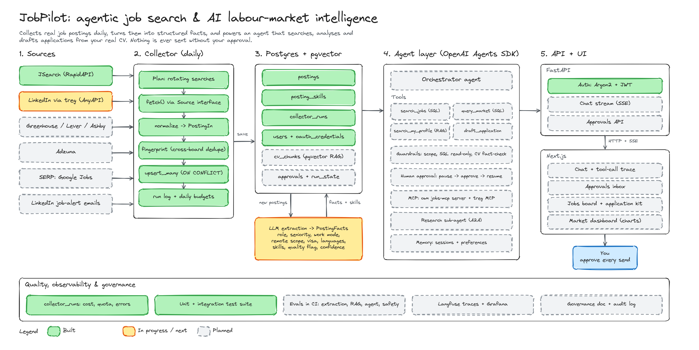

# Architecture

```
frontend (Next.js) --HTTP/SSE--> api/  -> services/ -> ai/ (Runner) -> tools/ -> db / external APIs
                                                      \-> guardrails/
workers/ (scheduler) -> collector/ -> db (postings)   rag/ <- profile documents
```

Rules:
- `api/` never contains agent logic; `tools/` never contain HTTP code.
- Business rules live in code (services/tools), not only in prompts.
- Any tool that sends, posts or deletes uses `needs_approval`.
- user_id always comes from `AppCtx` (server-side), never from a tool argument.
- Paused runs (RunState) are stored server-side only.

